# Entity Relationship Diagram (ERD) — **Rekapi**

Dokumentasi skema database PostgreSQL Supabase untuk SaaS **Rekapi**, mencakup arsitektur multi-tenant, seluruh tabel domain dari Fase 1 hingga Fase 3 (Migrasi 0001 s/d 0030), relasi entitas, enum, trigger konsistensi, serta Stored Procedures (RPC).

---

## 1. Visual Diagram Relasi Entitas (Mermaid ERD)

```mermaid
erDiagram
    %% Core Tenant & Organisasi
    businesses ||--o{ branches : "owns"
    businesses ||--o{ profiles : "employs"
    branches ||--o{ profiles : "stationed_at"

    %% Pelanggan & Penjualan (POS)
    businesses ||--o{ customers : "maintains"
    businesses ||--o{ products : "sells"
    products ||--o{ product_branch_stocks : "stocked_in"
    branches ||--o{ product_branch_stocks : "holds"

    businesses ||--o{ sales : "tenant"
    branches ||--o{ sales : "originates_at"
    profiles ||--o{ sales : "cashier"
    customers ||--o{ sales : "purchaser"
    sales ||--|{ sale_items : "contains"
    products ||--o{ sale_items : "item_def"
    sales ||--o{ sale_payments : "payments"
    branches ||--o{ sale_payments : "received_at"
    profiles ||--o{ sale_payments : "recorded_by"
    sales ||--o{ sale_edit_logs : "audit_logs"
    profiles ||--o{ sale_edit_logs : "edited_by"

    %% Bahan Baku, Supplier & Mutasi Persediaan
    businesses ||--o{ suppliers : "contracts"
    businesses ||--o{ raw_materials : "catalogs"
    raw_materials ||--o{ raw_material_branch_stocks : "material_stock"
    branches ||--o{ raw_material_branch_stocks : "stores"
    raw_materials ||--o{ inventory_mutations : "tracks"
    branches ||--o{ inventory_mutations : "occurs_at"
    profiles ||--o{ inventory_mutations : "logged_by"

    businesses ||--o{ purchases : "buys"
    branches ||--o{ purchases : "received_at"
    suppliers ||--o{ purchases : "supplied_by"
    purchases ||--|{ purchase_items : "contains"
    raw_materials ||--o{ purchase_items : "bought_item"

    %% Akuntansi & Keuangan
    businesses ||--o{ financial_accounts : "accounts"
    financial_accounts ||--o{ financial_transactions : "journal_entries"
    businesses ||--o{ expenses : "incurs"
    branches ||--o{ expenses : "allocated_to"
    financial_accounts ||--o{ expenses : "paid_from"

    businesses ||--o{ debts_payables : "owes"
    suppliers ||--o{ debts_payables : "payable_to"
    purchases ||--o| debts_payables : "credit_purchase_origin"
    businesses ||--o{ receivables : "collects"
    customers ||--o{ receivables : "owed_by"
    sales ||--o| receivables : "credit_sale_origin"

    businesses ||--o{ equity_records : "capital_records"
    financial_accounts ||--o{ equity_records : "capital_account"

    %% Langganan & Midtrans
    businesses ||--o{ subscriptions : "subscribes"
    subscription_plans ||--o{ subscriptions : "plan_tier"
    businesses ||--o{ payment_transactions : "invoiced_for"
    subscriptions ||--o{ payment_transactions : "covers"
```



---

## 2. Kamus Data Entitas Utama (Domain Tables)

### A. Tenant & Organisasi
* **`businesses`**: Data entitas bisnis multi-tenant. Menyimpan konfigurasi nama usaha, alamat, telepon, logo URL, rekening bank default, string QRIS statis, status langganan (`subscription_status`), dan tanggal berakhir masa trial.
* **`branches`**: Cabang fisik usaha. Setiap cabang memiliki nama unik dalam satu bisnis. Menjadi partition key untuk operasional kasir, stok, dan mutasi barang.
* **`profiles`**: Pengguna aplikasi yang tertaut ke Supabase Auth (`auth.users`). Memiliki atribut role (`owner`, `pegawai`), `business_id`, dan `branch_id` (wajib untuk pegawai, nullable untuk owner).

### B. Master Produk & POS Kasir
* **`products`**: Katalog menu/barang jadi. Memiliki barcode/SKU, nama, satuan (`unit`), kategori (`product_category`), harga jual (`selling_price`), status aktif/archived, dan harga modal/HPP (`cost_price`) yang hanya boleh dimodifikasi oleh Owner.
* **`product_branch_stocks`**: Saldo stok barang jadi per cabang. Dilengkapi ambang batas minimum (`min_stock`) untuk deteksi low-stock alert.
* **`customers`**: Direktori pelanggan. Menyimpan nama, nomor telepon, alamat, catatan, serta plafon limit piutang (`receivable_limit`).
* **`sales`**: Header transaksi penjualan.
  * `status`: Enum check `('completed', 'voided')`.
  * `payment_status`: Enum check `('unpaid', 'partial', 'paid')`.
  * `paid_amount`: Total uang riil yang sudah disetorkan/diterima pelanggan.
  * `due_date`: Tanggal jatuh tempo untuk penjualan kredit/tempo.
  * `idempotency_key`: UUID unik untuk menangkal duplikasi transaksi saat jaringan tidak stabil.
* **`sale_items`**: Rincian produk dalam transaksi penjualan. Mengunci snapshot harga jual (`price`) dan harga modal (`cost_price`) saat transaksi terjadi.
* **`sale_payments`**: **Single Source of Truth (SSOT)** riwayat pembayaran kasir. Mencatat setiap pembayaran DP maupun cicilan pelunasan secara immutable dengan nomor pembayaran `PAY/YYYYMMDD/XXXX`, tautan ke `account_id`, `recorded_by`, dan `idempotency_key`.
* **`sale_edit_logs`**: Catatan jejak audit modifikasi transaksi penjualan (data sebelum, data sesudah, selisih kuantitas, dan pengguna pengedit).

### C. Bahan Baku, Supplier & Mutasi Persediaan
* **`suppliers`**: Direktori pemasok bahan baku (nama kontak, telepon, alamat, syarat pembayaran).
* **`raw_materials`**: Master bahan baku mentah (nama, satuan baku, ambang batas minimum peringatan stok, `cost_per_unit`).
* **`raw_material_branch_stocks`**: Saldo stok fisik bahan baku pada masing-masing cabang (`quantity`).
* **`inventory_mutations`**: Kartu mutasi stok bahan baku (*immutable persediaan ledger*). Mencatat jenis mutasi (`purchase_in`, `usage_out`, `adjustment`, `transfer_in`, `transfer_out`, `waste_loss`), kuantitas, serta saldo berjalan (`balance_after`).
* **`purchases` & `purchase_items`**: Transaksi pengadaan/pembelian stok dari supplier, mencatat faktur pembelian, harga beli satuan, dan status penerimaan barang. Terintegrasi penuh dengan kas & utang melalui atribut:
  * `payment_status`: Enum check `('paid', 'unpaid')`.
  * `payment_method`: Tipe bayar (`cash`, `transfer`, `tempo`).
  * `account_id`: Rekening/kas sumber bayar (`financial_accounts.id`).
  * `paid_amount`: Nominal pembayaran riil yang sudah dikeluarkan.
  * `due_date`: Tanggal jatuh tempo utang supplier.

### D. Keuangan & Akuntansi
* **`financial_accounts`**: Akun rekening kas & bank penampung dana (tipe: `cash`, `bank`, `e_wallet`). Memiliki saldo berjalan (`current_balance`) dan flag `is_default_cash` / `is_default_bank`.
* **`financial_transactions`**: **Single Source of Truth (SSOT)** buku besar jurnal arus kas. Mencatat arah arus dana (`type: 'income' | 'expense'`), kategori (`sale`, `receivable_payment`, `debt_payment`, `expense`, `capital_injection`, `owner_drawing`, `transfer`), referensi entitas asal, dan nominal.
* **`expenses`**: Pencatatan biaya operasional harian (gaji, listrik, sewa, marketing, perlengkapan, dll.) yang langsung memotong saldo rekening penampung kas/bank.
* **`debts_payables`**: Buku utang usaha kepada supplier atau pihak ketiga, tanggal jatuh tempo, dan riwayat pembayaran cicilan. Memiliki partial unique index `uq_debts_business_purchase (business_id, purchase_id) WHERE purchase_id IS NOT NULL` untuk menjamin sinkronisasi 1:1 dengan transaksi pembelian tempo dari modul bahan baku.
* **`receivables`**: Kartu piutang usaha. Memiliki partial unique index `uq_receivables_business_sale (business_id, sale_id) WHERE sale_id IS NOT NULL` untuk menjamin sinkronisasi 1:1 dengan transaksi penjualan POS.
* **`equity_records`**: Buku modal pemilik (setoran modal awal, tambahan modal kerja, serta penarikan prive pribadi).

### E. Billing & Langganan Midtrans
* **`subscription_plans`**: Master tier langganan (`trial`, `lite`, `pro`, `enterprise`) beserta harga, fitur, dan batas maksimal cabang.
* **`subscriptions`**: Status aktif langganan per bisnis, tanggal berakhir (`expires_at`), serta order ID transaksi pembayaran.
* **`payment_transactions`**: Log histori pembayaran langganan melalui payment gateway Midtrans (Snap Token, tipe bayar, status transaksi, payload webhook).

---

## 3. Tipe Data & Status Enum

```sql
-- Peran Pengguna
create type user_role as enum ('owner', 'pegawai');

-- Kanal Penjualan
create type sale_channel as enum (
  'offline', 'gofood', 'grabfood', 'shopeefood', 'whatsapp', 'qris', 'lainnya'
);

-- Metode Pembayaran
create type payment_method as enum (
  'cash', 'qris', 'transfer', 'lainnya'
);

-- Kategori Produk
create type product_category as enum (
  'makanan', 'minuman', 'snack', 'paket', 'dessert', 'bahan', 'retail', 'jasa', 'lainnya'
);

-- Status Langganan
create type subscription_status as enum (
  'trial', 'active', 'past_due', 'canceled', 'expired'
);

-- Status Penjualan (Tabel sales)
status in ('completed', 'voided')

-- Status Pembayaran (Tabel sales & receivables)
payment_status in ('unpaid', 'partial', 'paid')

-- Jenis Mutasi Stok Bahan Baku
mutation_type in ('purchase_in', 'usage_out', 'adjustment', 'transfer_in', 'transfer_out', 'waste_loss')
```

---

## 4. Stored Procedures / RPC (Atomic Database Functions)

### 1. `create_sale_atomic`
* **Tujuan:** Membuat transaksi penjualan kasir (POS) secara atomik.
* **Parameter:** `p_business_id`, `p_branch_id`, `p_user_id`, `p_channel`, `p_payment_method`, `p_total`, `p_items (jsonb)`, `p_idempotency_key`, `p_invoice_number`, `p_customer_id`, `p_payment_status`, `p_paid_amount`, `p_due_date`, `p_notes`, `p_account_id`.
* **Jaminan Transaksi:**
  1. Validasi otorisasi pemanggil & integritas cabang.
  2. Pengecekan idempotensi untuk menangkal klik ganda.
  3. Pemotongan stok produk cabang secara otomatis (`product_branch_stocks`).
  4. Pencatatan piutang pelanggan ke `receivables` jika transaksi berstatus `unpaid` atau `partial`.
  5. Pencatatan mutasi penerimaan kas nyata (DP) ke `sale_payments` dan `financial_transactions` tanpa membuat penerimaan kas fiktif untuk piutang tanpa DP.

### 2. `record_sale_payment_atomic`
* **Tujuan:** Mencatat pembayaran cicilan atau pelunasan piutang penjualan secara terpadu.
* **Parameter:** `p_business_id`, `p_sale_id`, `p_amount`, `p_payment_method`, `p_account_id`, `p_recorded_by`, `p_payment_date`, `p_notes`, `p_idempotency_key`, `p_user_id`.
* **Jaminan Transaksi:**
  1. Menerima alias `p_recorded_by` dan `p_user_id` dengan fallback aman ke `auth.uid()`.
  2. Menerima `p_idempotency_key` bertipe teks dan memvalidasi format UUID menggunakan pola regex resmi sebelum casting ke UUID.
  3. Mengunci baris `sales` dan `receivables` menggunakan `FOR UPDATE` untuk mencegah race-condition.
  4. Menolak pembayaran jika nominal melebihi sisa tagihan piutang (*overpayment protection*).
  5. Memperbarui `paid_amount` dan `payment_status` pada `sales` dan `receivables` secara simultan.
  6. Menambahkan entri pembayaran pada `sale_payments` dan menambah saldo rekening pada `financial_accounts` serta mencatat jurnal di `financial_transactions`.

### 3. `void_sale_atomic`
* **Tujuan:** Membatalkan transaksi penjualan (Soft-Void) demi menjaga integritas audit finansial dan inventaris.
* **Parameter:** `p_business_id`, `p_sale_id`, `p_user_id`, `p_reason`.
* **Jaminan Transaksi:**
  1. Otorisasi ketat: hanya dapat dieksekusi oleh Owner.
  2. Menandai penjualan sebagai `status = 'voided'`.
  3. Mengembalikan seluruh kuantitas stok produk yang terjual kembali ke `product_branch_stocks`.
  4. Menandai piutang terkait sebagai voided.
  5. Membalikkan saldo kas/bank sejumlah akumulasi uang yang pernah disetor pada `sale_payments`.

### 4. `record_inventory_mutation_atomic`
* **Tujuan:** Mencatat kartu stok mutasi bahan baku dan memperbarui saldo fisik secara bersamaan.
* **Parameter:** `p_business_id`, `p_branch_id`, `p_raw_material_id`, `p_type`, `p_quantity`, `p_notes`, `p_user_id`.
* **Jaminan Transaksi:**
  1. Menghitung saldo berjalan (`balance_after`) secara kumulatif.
  2. Menolak mutasi jika kuantitas mengakibatkan saldo negatif pada operasi keluar (`P0003`).
  3. Menjaga sifat *immutable* pada riwayat buku besar mutasi persediaan.
